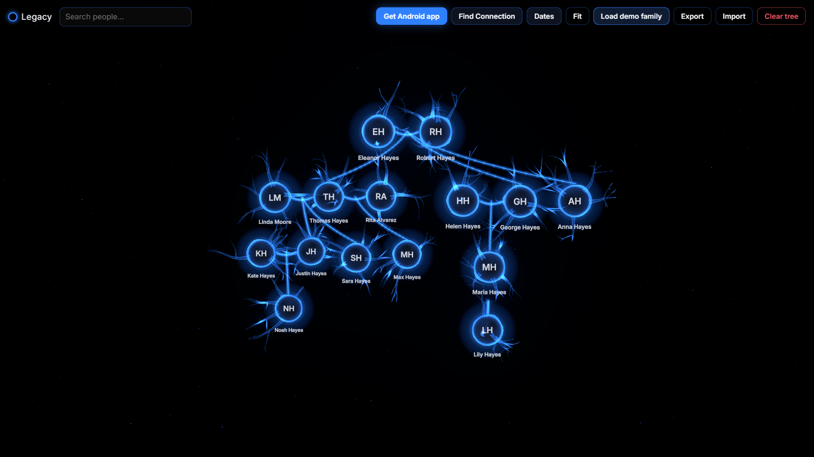
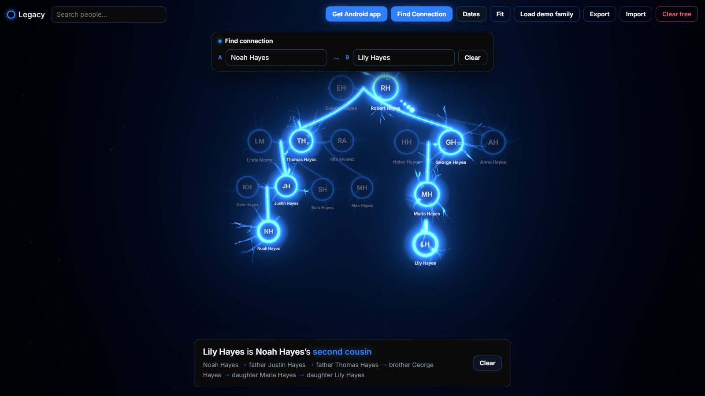
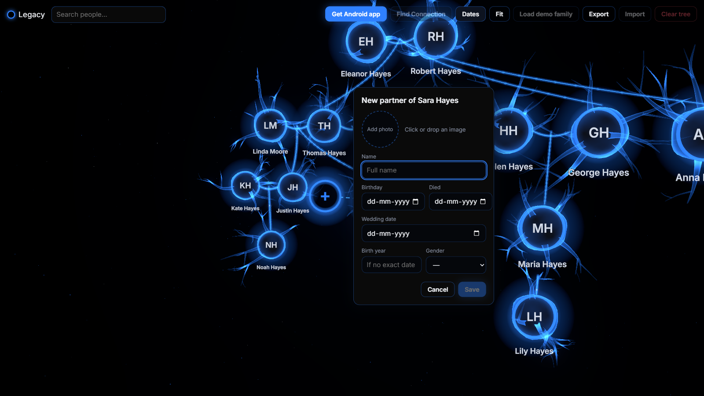
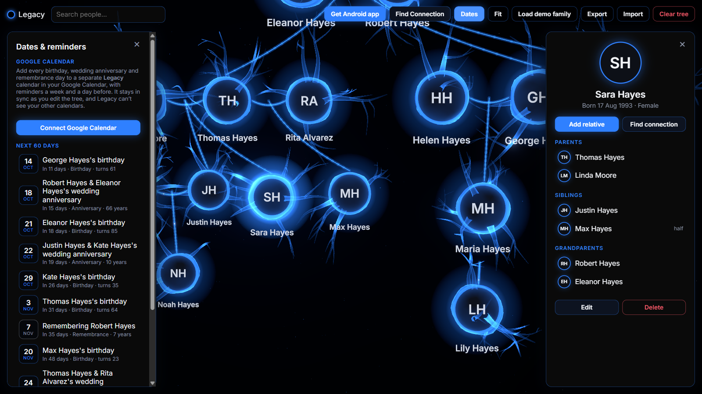
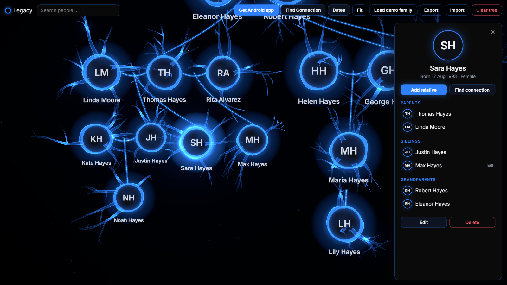
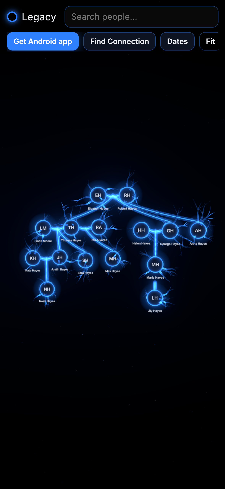

<div align="center">


# Legacy

**Your family tree as a living 3D network.** Every person is a glowing neuron, every bond is a firing connection. Legacy can find how any two relatives are related and remind you of every birthday and anniversary.

[**Open the app →**](https://legacy-iota-two.vercel.app) &nbsp;·&nbsp; [**Download for Android (APK)**](https://legacy-iota-two.vercel.app/Legacy.apk)



</div>

---

## Highlights

|  |  |
|---|---|
|  | **Find Connection.** Pick any two people and Legacy finds the shortest path between them and names the relationship in plain words: *"Lily is Noah's second cousin"*, *"Jessy is Eric's mother's first cousin's wife"*, *"grand-uncle"*, *"step-son"*. The rest of the tree dims, the path lights up, and a pulse travels along it from one person to the other. |
|  | **Add relatives where they belong.** Select someone and choose *Parent, Partner, Child* or *Sibling*. The camera swings round, a ghost node appears exactly where the new person will sit, the connection draws itself in, and the form opens beside it. |
|  | **Dates & reminders, synced to Google Calendar.** Birthdays, wedding anniversaries and remembrance days are listed for the next 60 days (*"turns 36"*, *"10 years"*). One click puts them all into a separate **Legacy** calendar in Google Calendar, as yearly events with reminders a week and a day before. Edits re-sync automatically. |
|  | **Everyone's details at a glance.** Click a person to see their photo, dates, notes and direct relatives, and click any relative to fly there. You can edit details, link an existing person as a parent, add a wedding date, or remove a single link. |

<p align="center"></p>

## Features

- **A genuinely 3D tree.** Generations stack vertically, couples sit side by side, and children hang from the middle of their parents' connection. Sibling branches fan out in depth, and the whole tree curves gently toward you. An in-law's own family sits just behind them instead of off to the side. Orbit, zoom and pan with a mouse or touch.
- **Relationship naming that reads naturally.** It covers parents through great-great-grandparents, siblings and half-siblings, aunts and uncles, grand-aunts and grand-uncles, and cousins of any degree. Cousins in another generation are described through the chain (*"father's second cousin"*, *"first cousin's son"*). It also handles spouses, in-laws and step-relations, uses neutral wording when gender is unknown, and shows a step-by-step chain under every answer.
- **Remarriages and blended families.** When a child is added, Legacy asks which partner is the other parent. When a partner is added, it asks whether they're also the parent of existing children, so they aren't wrongly shown as step-children. It can also create a placeholder parent so siblings can be connected.
- **Photos.** Click or drag-and-drop a photo onto a person. Photos are cropped and resized to 256×256 before saving, so the tree stays fast.
- **Private by default.** There's no account and no server: the tree lives in your browser's own storage (IndexedDB). Google Calendar is the only outside service, it's opt-in, and it only gets access to the one calendar Legacy creates.
- **Export / Import.** Back up the whole tree, photos included, as a single JSON file and restore it anywhere: another browser, the phone app, or a family member's device.
- **Android app.** The same app packaged for Android, with native Google sign-in for Calendar sync, the share sheet for backups, back-button support and an edge-to-edge dark UI.
- **Built for big families.** Geometries, materials and photo textures are shared, so the tree stays smooth with hundreds of people.

## Using it

| To… | Do this |
|---|---|
| Start | Click the glowing ring to add the first person, or **Load demo family** to explore |
| Add someone | Select a person → **Add relative** |
| See how two people are related | **Find Connection** → pick two people (or click them) |
| Add a birthday or death date | Select a person → **Edit** |
| Add a wedding date | Select a person → under **Partners**, **+ Add wedding date** |
| Get reminders | **Dates** → **Connect Google Calendar** |
| Back up / move your tree | **Export** to a file, then **Import** it elsewhere |

## Tech

- **React 19 + TypeScript + Vite**
- **three.js** through **@react-three/fiber** and **@react-three/drei**, with **@react-three/postprocessing** bloom. Neurons are procedural: tapered branching dendrites built in code, and custom GLSL shaders for the membrane glow, firing impulses and drifting motes.
- **zustand** for state, **Dexie** (IndexedDB) for storage, **framer-motion** for panel animations
- **Google Identity Services** + Calendar API on the web; a small native **Capacitor** plugin (Play services `AuthorizationClient`) in the Android app
- **Capacitor 8** for the Android build
- **Vitest**: 125 unit tests covering relationship naming, layout, path-finding, the add-relative logic, import/export and calendar sync

### How the pieces fit

```
src/lib/                 pure logic, no UI (unit tested)
  graph.ts               relationship graph, shortest path, siblings
  relationship.ts        names a path: "mother's first cousin's wife", "grand-uncle", …
  layout.ts              computeLayout(people, relationships) → 3D position per person
  addRelative.ts         what adding a parent / partner / child / sibling creates
  dates.ts               birthdays, anniversaries, remembrance days, upcoming list
  calendarSync.ts        diff-based Google Calendar sync (idempotent, self-healing)
  googleAuth.ts          Google sign-in on the web and in the Android app
  db.ts io.ts photo.ts   storage, export/import, photo resizing
src/store/               app state and actions
src/components/scene/    the 3D scene: neurons, fibres, impulses, ghost node, camera
src/components/ui/       panels, forms, search, dialogs
android/                 Capacitor Android project (incl. GoogleAuthPlugin.java)
```

## Run it locally

```bash
npm install
npm run dev        # http://localhost:5173
npm test           # unit tests
npm run build      # type-check + production build into dist/
```

To try it on your phone over Wi-Fi, run `npm run dev -- --host` and open the network URL it prints.

### Google Calendar sync (optional)

1. In [Google Cloud Console](https://console.cloud.google.com/), create a project and enable the **Google Calendar API**.
2. Under **Google Auth Platform**, set up the consent screen (External, in testing mode) and add yourself as a test user.
3. Create an OAuth client of type **Web application**, with your site's address (and `http://localhost:5173`) as authorized JavaScript origins.
4. Put the client ID in `.env.local`:
   ```bash
   VITE_GOOGLE_CLIENT_ID=your-id.apps.googleusercontent.com
   ```
5. For the Android app, also create an **Android** OAuth client with the package name `com.justin.family3d` and your release key's SHA-1.

Legacy only ever requests the `calendar.app.created` scope, so it can manage the calendar it creates but can't see your other calendars.

### Android build

Requires JDK 21 and the Android SDK.

```bash
npm run build && npx cap sync android
cd android && ./gradlew assembleRelease     # → app/build/outputs/apk/release/app-release.apk
```

Release signing is configured through `android/keystore.properties`, which isn't included in the repo; it holds `storeFile`, `storePassword`, `keyAlias` and `keyPassword`.

### Deploy

Legacy is a static site; the live version runs on Vercel. Build it, then upload `dist/` together with the APK:

```bash
npm run build
D=.deploy/legacy; mkdir -p $D && cp -r dist/. $D/ && cp android/app/build/outputs/apk/release/app-release.apk $D/Legacy.apk
(cd $D && vercel deploy --prod --yes)
```
